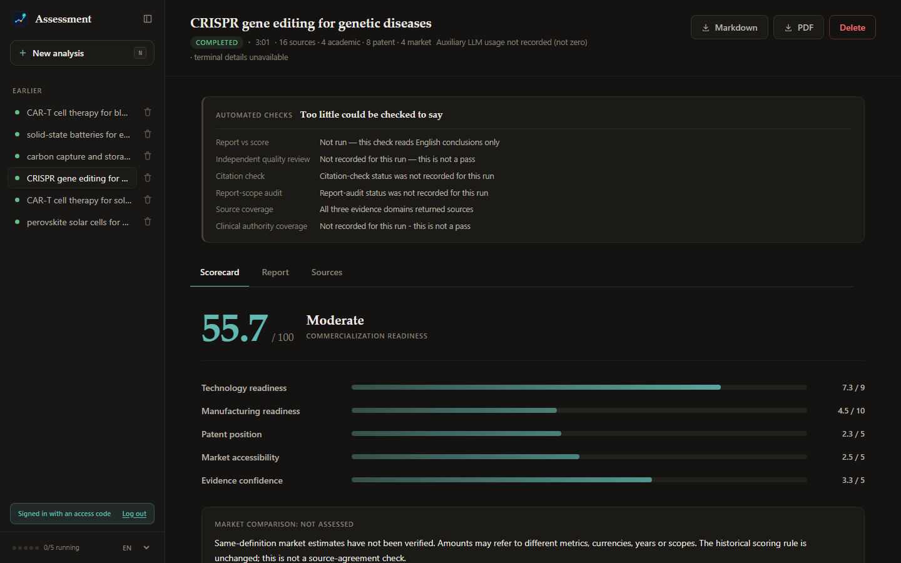
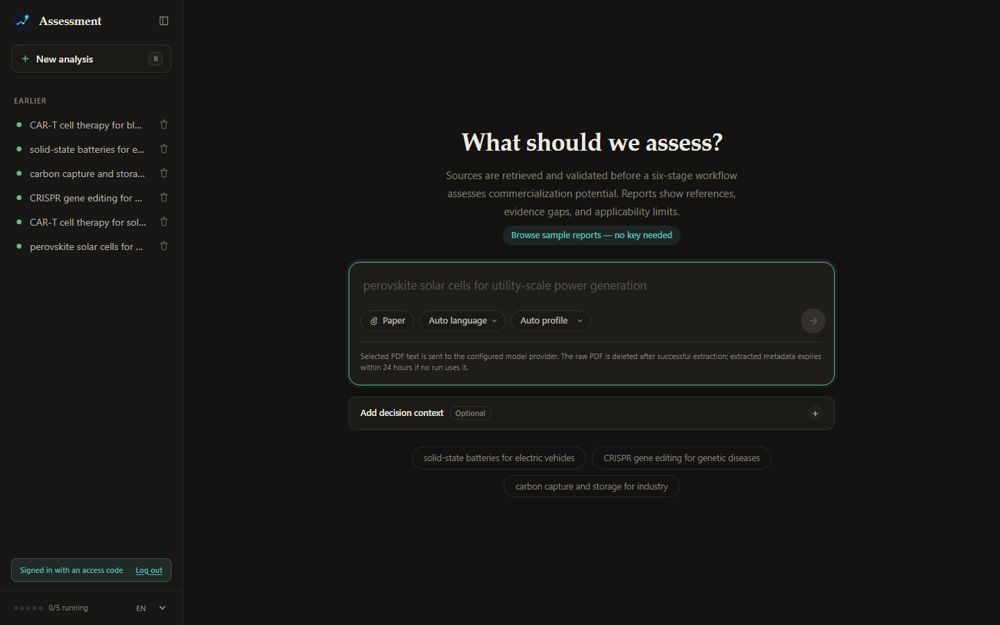
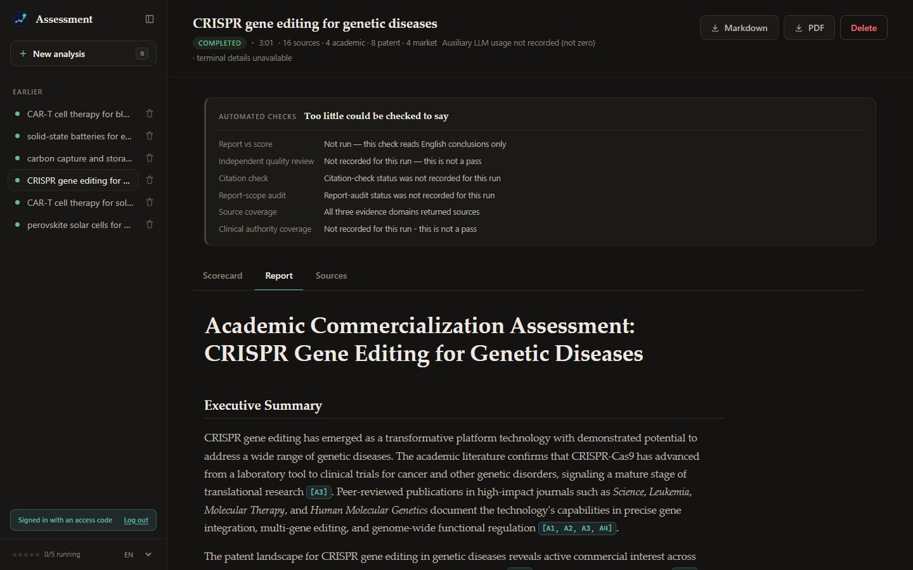

# Academic Commercialization Assessment Agent

Turn a paper or research topic into a **source-linked commercialization assessment draft**:
a scorecard for technology readiness, manufacturing, patents and market, with
citations to registered sources and the risks spelled out.

[Open the application](https://academic-commercialization-agent.up.railway.app) · [Read sample reports — no key needed](https://academic-commercialization-agent.up.railway.app/samples) · [Run locally](#quick-start) · [中文](README.zh-CN.md)



*Current interface, captured 2026-10-20, showing a real run from 2026-08-09. That run predates today's automated checks, which the panel states; it is not a current-model result.*

**Try it without keys:** the [sample reports page](https://academic-commercialization-agent.up.railway.app/samples)
shows three finished assessments and makes no model or search request. The same
reports are in [examples/](examples/README.md), for instance
[Solid-state batteries for electric vehicles](examples/solid-state-batteries-ev.md)
([frozen 2026-07-19 version, 9673a83](https://github.com/shuxiachai/academic-commercialization-agent/blob/9673a8346c15f11b989ce8fd2d85be484d1c27b3/examples/solid-state-batteries-ev.md)).
Starting a new analysis needs an operator-issued access code **or** BYOK
(your own LLM API key and model, plus a Tavily or Serper search key), and incurs provider usage.
The screenshot and samples are different historical runs; neither represents
current model accuracy or an up-to-date market assessment.

Built with Python, CrewAI, FastAPI and a build-free JavaScript client.
[Start here: documentation and repository map](docs/README.md) · [Case study](docs/portfolio-case-study.md)

**Finding your way around:** the application is `src/academic_agent/`, `api/`,
`web/` and `ui/`; tests are in `tests/` and `e2e/`. The many Python files at the
root are benchmark commands and frozen experiment runners whose protocols bind
their paths, so they stay put; none is needed to run the app. See the
[repository map](docs/README.md#repository-map) for every directory.

<a id="english"></a>

## What it does

- Submit a research topic or attach a paper PDF; choose the report language
  and scoring profile.
- Deterministic code retrieves and validates sources first; six LLM stages
  then reason over that frozen evidence. Autonomy is limited on purpose.
- The scorecard covers TRL, MRL, patent strength, market accessibility and
  evidence confidence. The weighted total is computed by code, not the model.
- Follow progress, inspect citations and reliability warnings, export Markdown
  or PDF, and share a run link.
- In Sources, find a saved source by ID or keyword and read its saved text
  without a model call. Saved text is not the paper's full text or verified
  claim support; see the [operating guide](docs/operating-guide.md#web-cli-and-http-api).
- Optionally add Decision Context: the report distinguishes exploratory
  orientation from a specific actor's decision, and whether a threshold was
  approved by the decision owner.
- Resume an interrupted run from its last validated checkpoint. The resumed
  run is a new linked run; the original is never overwritten.
- Paid requests get [durable receipts](docs/operating-guide.md#paid-request-receipts):
  after a lost reply or a refresh, the accepted run, PDF or resumed run can be
  recovered for up to 24 hours without paying again.

A report supports research triage; it is **not** technical, legal, regulatory,
investment or freedom-to-operate due diligence. A valid citation ID does not
establish that the source supports the claim.

## Architecture

```text
Topic / PDF + optional Decision Context
                   │
Deterministic retrieval → validation → frozen source registry
                   │
         ┌─────────┼─────────┐
     Academic    Patent    Market
         └─────────┼─────────┘
                 Writer
                   │
                 Reviewer
                   │
                  Scorer → deterministic weighted total
                   │
        Shared run artifacts + final run status
                   │
       FastAPI / browser / CLI / recovery
```

The three evidence specialists run in parallel; Writer, Reviewer and Scorer
follow in sequence. A stage is not a promise of exactly one model request.
See the [code map and contribution rules](AGENTS.md) before changing orchestration.

| Boundary | Implemented behaviour |
|---|---|
| Evidence | Source-native clients plus web search; URL/DOI checks, provenance tiers, deduplication and registered source IDs |
| Output | Pydantic contracts, guardrails, deterministic scoring and bounded Reviewer corrections |
| Quality | Non-blocking, precision-first claim/citation screens; a check that could not run is reported separately from a pass |
| Runtime | One subprocess per run, content-addressed checkpoints, recovery into a new linked run, and a final status written exactly once |
| Cost | Shared admission for runs and PDF extraction, a persistent daily quota, and usage reported as complete, lower-bound or unavailable |
| Observability | Optional redacted OpenTelemetry/OpenInference traces to Phoenix or another OTLP collector |
| Delivery | FastAPI, vanilla HTML/CSS/ES modules, Docker and Railway; one application replica |

### Measured results

The frozen baseline contains **10 topics × 3 live repetitions**:

| Check | Observed |
|---|---|
| End-to-end completion | **30/30** |
| TRL calibration | **26/30** |
| Weighted formula correctness | **30/30** |
| Complete report structure | **30/30** |
| Unsupported numeric lines | **0 across 30 reports** |

These are different checks, not a combined accuracy score. Expected TRL ranges
were adjusted after early observations, so this is not independent held-out
validation. The uncited-numeric proxy does not measure all hallucinations.
Seven of ten topics met their TRL range in all three runs.

**Held-out check.** On ten new topics with ranges fixed from external evidence
before any run (`qwen3.7-plus`, 2026-10-18), **21/30 runs fell in range**, the
pre-registered "supported" threshold. Scores were compressed toward 7, though:
no run scored above 7, so mature, deployed technologies were under-scored. See the
[held-out result](docs/results-2026-10-18-heldout-trl-v1.md).

A second held-out cohort ran on 2026-10-19 with `qwen3.8-max` and the revised
market retrieval. **25/30 runs fell in range**, and 11 runs scored 8–9 on
proven technologies. Low-maturity topics were not inflated, though the two
lowest ones were scored below their floor. The topics and the model also
changed, so the improvement is not attributed to any single change. Treat TRL
as a coarse signal. See the [v2 result](docs/results-2026-10-19-heldout-trl-v2.md).
The public deployment has since moved to the smaller `qwen3.8-27b`, which
neither held-out cohort measured.

Other completed evidence:

- **90-cell topology ablation:** the four-node arm used 54.89% fewer median
  tokens and 47.03% lower median cost than the six-node arm. Six nodes were
  not established as universally necessary.
- **Five-reviewer utility study:** 20 eligible judgments; the registered success
  rule failed despite a 6:4 full-workflow preference in each round.
- **Two target-user pilot:** both retained `DEFER` and answered `MAYBE` to reuse;
  neither checked external sources. This does not establish product adoption.
- **Recovery:** 30/30 offline fault-injection recoveries completed; one production
  recovery reused four committed nodes. This is not an exactly-once or general
  cost-saving guarantee.
- **Runtime RTI02:** one normal Qwen completion passed 12/12 primary final-status
  checks, with a disclosed minor observer-cadence deviation. Timeout/fallback
  paths and general report quality were not validated by that run.

Protocols, source artifacts and limitations are linked in the
[current evidence ledger](docs/evidence-status.md).

## Quick start

Use Python 3.11 or 3.12 for the CI-tested environment and
[uv](https://docs.astral.sh/uv/). Dependency installation needs network access;
the default test suite does not call providers.

```bash
git clone https://github.com/shuxiachai/academic-commercialization-agent.git
cd academic-commercialization-agent
uv sync
```

Copy [.env.example](.env.example) to `.env`. For Qwen, set these values and
replace the placeholders locally; do not commit or share keys:

```dotenv
LLM_PROVIDER=qwen
DASHSCOPE_API_KEY=your-key
QWEN_MODEL=qwen3.8-27b
QWEN_API_BASE=https://dashscope.aliyuncs.com/compatible-mode/v1
TAVILY_API_KEY=your-search-key
```

Choose the endpoint matching your operator account/region. This project's
browser BYOK default uses the China-region endpoint. With multiple LLM keys
present, set `LLM_PROVIDER` explicitly; otherwise auto-selection is
DeepSeek → Qwen → Anthropic → OpenAI. Tavily takes precedence over Serper
when both search keys are present. Remove unused placeholder keys.

```bash
uv run uvicorn api.main:app --reload
# Browser: http://localhost:8000  (sample reports: http://localhost:8000/samples)
# Alternative CLI (starts real provider work):
uv run academic_agent --topic "solid-state batteries for electric vehicles"
```

Real analysis incurs provider usage. Duration is provider-bound: observed Qwen
completions include 306 and 885 seconds, not a promised three-minute SLA.
See the [operating guide](docs/operating-guide.md) for HTTP endpoints, output
files, Docker, access codes, BYOK, tracing and recovery.

## Security and deployment

Run URLs carry **128 bits of randomness** and act as read capabilities:
anyone with the full URL can read that run until retention removes it.
Changing a code-owned run additionally requires its owner/admin code; ownerless
BYOK runs have no second server-side identity. Do not publish private run URLs.

Before public deployment, configure access control, paid-operation limits,
retention and persistent storage. PDF extraction is a paid operation too.
Use **one application replica / one Uvicorn worker**: in-memory ownership and
file-backed quotas are not a distributed queue. See
[deployment controls](docs/operating-guide.md#deploying-publicly) and
[checkpoint recovery](docs/checkpoint-recovery.md).

## Tests and benchmark

The pre-consolidation baseline at `0fdaa76` passed **2071 tests and 678
subtests**. CI covers Linux/Windows × Python 3.11/3.12, latest Ruff, narrow
Pylint, an 85% coverage floor, zero-provider Chromium smoke, and Docker.
These do not constitute a paid-provider production SLO.

```bash
uv run pytest -q
uv run --with ruff ruff check .
# Scheduling preview only; no provider requests:
uv run python benchmark.py --dry-run
```

### Benchmark

New measurements use immutable versioned batches; historical outputs are not
overwritten. Reuse requires an explicit matching batch and intact artifacts.
Reported costs cover Crew nodes, not helper/PDF/search charges. See the
[execution and accounting contract](docs/operating-guide.md#benchmark).

| # | Topic | Expected TRL | Industry |
|---|-------|-------------|---------|
| 01 | CAR-T cell therapy for blood cancers | 7–9 | Biomed |
| 02 | mRNA vaccines for cancer immunotherapy | 6–8 | Biomed |
| 03 | solid-state batteries for electric vehicles | 5–7 | Energy |
| 04 | perovskite solar cells for utility-scale power generation | 6–8 | Clean Energy |
| 05 | CRISPR gene editing for genetic diseases | 7–9 | Biomed |
| 06 | carbon capture and storage for industrial emissions | 6–8 | Climate |
| 07 | cultivated meat for food industry | 6–8 | Food |
| 08 | quantum computing for drug discovery | 2–4 | Computing |
| 09 | graphene-based flexible electronics | 3–5 | Materials |
| 10 | room temperature ambient pressure superconductors | 1–2 | Materials |

The [benchmark guide](docs/operating-guide.md#benchmark) explains repetitions,
frozen evidence and paid-run precautions. Do not change scoring rules to
improve these historical numbers.

## Repository layout

The application is in a handful of directories. Most of the Python files at
the repository root are something else: frozen experiment runners.

| Path | What it is |
|---|---|
| `src/academic_agent/` | Pipeline, retrieval, scoring and runtime. Some modules are experiment libraries; the [code map](AGENTS.md#layout-and-boundary-specific-reading) says which |
| `api/`, `web/`, `ui/` | FastAPI server, browser client and shared presentation |
| `tests/`, `e2e/` | Offline test suite (no provider calls) and opt-in browser journeys |
| `examples/` | [Sample reports](examples/README.md), also served at `/samples` |
| `scripts/` | Operational report, offline audits and scripted demos |
| `docs/` | Current guides plus dated protocols, results and errata; [start at the map](docs/README.md) |
| Root `benchmark*.py` | The benchmark commands above |
| Other root `*.py` (`openalex_*`, `evidence_gap_*`, `report_evidence_*`, `ablation*`, …) | Experiment runners. Not needed to run or understand the application |

The experiment runners stay at the root deliberately: their protocols lock
source file paths and hashes, so moving them would invalidate those records
(see the [experiment index](docs/experiment-index.md)). New tools go under `scripts/`.

## Limitations and open questions

Open gaps: qualitative source entailment, independently measured decision
utility, multilingual/short/non-technical benchmark coverage, legacy metadata
read-state clarity, and single-replica scale. More agents, a vector database
or Kubernetes would not by themselves resolve these.

**Market scoring.** Market scorecards disclose
[unverified estimate comparability](docs/results-2026-09-11-market-score-delivery-disclosure.md):
the historical cap's limitation is visible, but the underlying market-scoring
policy is neither fixed nor validated. New results also show
[pre/post cap scores and the actual deduction](docs/results-2026-09-12-numeric-token-and-cap-provenance.md);
missing historical receipts cannot be reconstructed. The
[20-source inspection](docs/results-2026-09-12-market-source-followup.md) still
found no fully comparable real pair.

**Tool Calling.** Three capabilities have separate release boundaries:

- *Saved-source location* has an opt-in production page/API: at most one
  bounded Qwen selection from saved IDs/titles, then the exact saved text. It
  writes no research answer and runs no new search; owner authorization, transfer
  consent, paid admission and receipts apply
  ([operating contract](docs/operating-guide.md#optional-saved-source-locator)).
  One prepared production acceptance on 2026-09-26 delivered the chosen source
  and recovered its receipt after a redeploy (1,199 tokens, a USD 0.000764436
  frozen-rate estimate); see the
  [qualified acceptance record](docs/results-2026-09-26-production-source-locator-acceptance.md).
  That is one delivery observation, not unseen accuracy. **Paid execution was
  closed again with zero feature budgets; it is not permanently enabled.**
- *Supplementary retrieval* remains zero-call shadow mode in production; its
  latest unseen evaluation failed the admission gates.
- *Generated evidence follow-up answers* are experimental, not a production
  feature. Tool execution or valid JSON does not prove claim support.

Hypotheses, failures and closed batches are kept in the
[evidence ledger](docs/evidence-status.md#tool-calling-experiments) and
[experiment archive](docs/experiment-index.md); they are not combined into a
general accuracy score.

## Documentation

- [中文项目说明](README.zh-CN.md)
- [Documentation map](docs/README.md) — reading paths, repository layout and
  the boundary between current guides, historical experiments and local/private material.
- [Evidence ledger](docs/evidence-status.md) — measurements and what they cannot prove.
- [Operating guide](docs/operating-guide.md) — setup, API, deployment and scoring.
- [Contributing](CONTRIBUTING.md) and [AGENTS.md](AGENTS.md) — tested constraints
  and rejected approaches.
- [Experiment archive](docs/experiment-index.md) — unchanged protocols, results
  and errata; older numbers are historical snapshots.

## Screenshots

<details>
<summary>Home and report views — current interface, captured 2026-10-20</summary>

Real historical runs (August 2026) opened in the current interface on a local
copy; no model or search request was made for these images. The earlier
captures are at [a343a95](https://github.com/shuxiachai/academic-commercialization-agent/commit/a343a95590ad83f0edec4002e3489355fc96a512).




</details>

## Author and more projects

Created by [shuxiachai](https://github.com/shuxiachai).
Contributors: [Song Guoyu (@7776403yu)](https://github.com/7776403yu),
[@xiaobaozhou165-sudo](https://github.com/xiaobaozhou165-sudo).
Explore [more projects on the author's GitHub profile](https://github.com/shuxiachai).

## License

[MIT](LICENSE). Contributions are accepted under the same license; see
[CONTRIBUTING.md](CONTRIBUTING.md#pull-requests-and-privacy).

<a id="chinese"></a>

For Chinese documentation, open [README.zh-CN.md](README.zh-CN.md).
