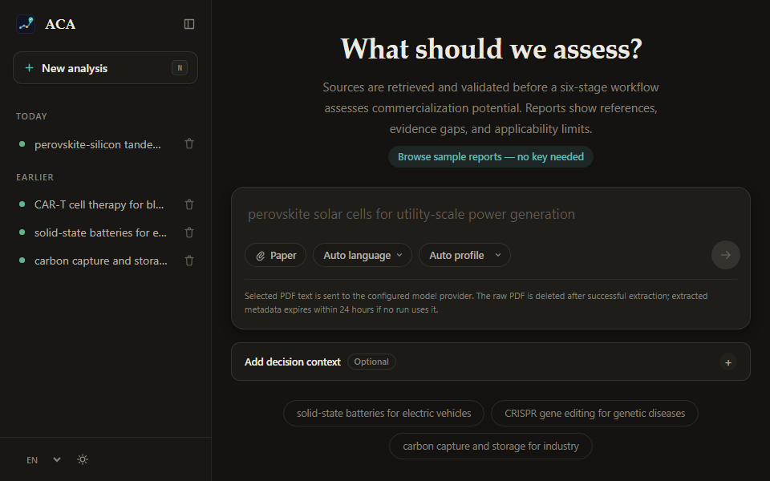
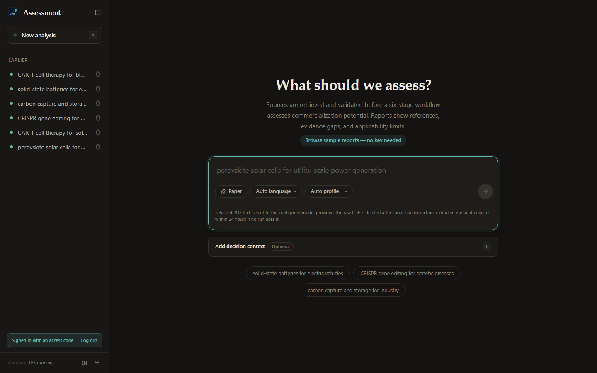
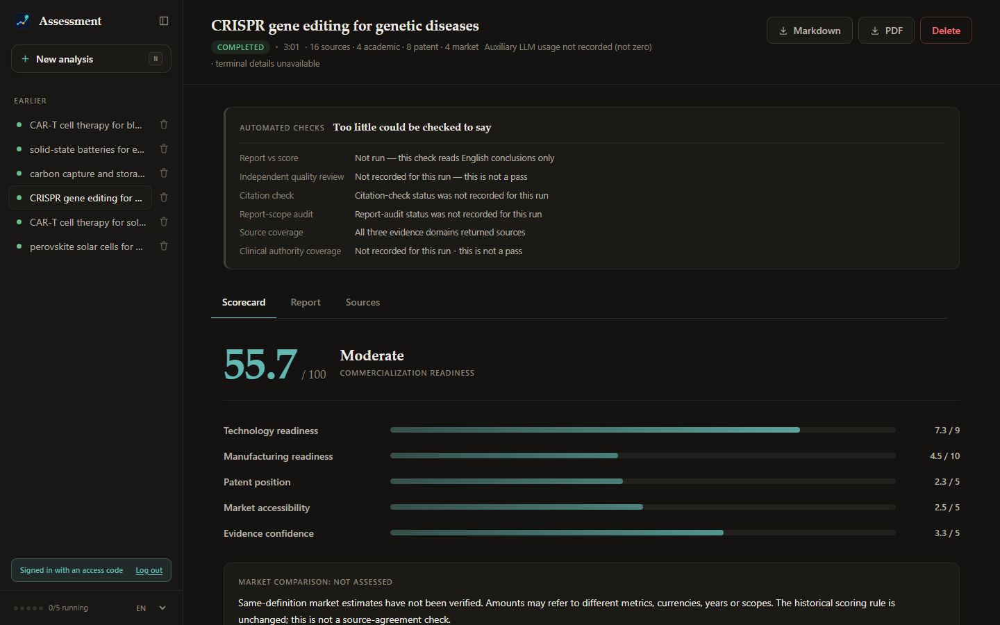
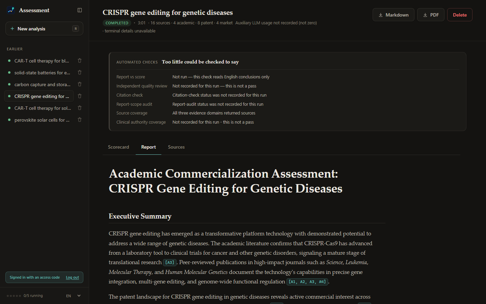

# Akademik Ticarileştirme Değerlendirme Ajanı

**Makale girer, kaynaklı ticarileştirme ön değerlendirmesi çıkar.** Çoklu ajan tabanlı bir LLM işlem hattı, bir araştırma makalesini veya konusunu kayıtlı kaynaklara atıflar ve açıkça belirtilen risklerle birlikte teknoloji hazırlığı, üretim, patent ve pazar puan kartına dönüştürür. Deneyleri, başarısızlıklar da dahil olmak üzere protokolleriyle birlikte yayımlanır.

[](https://github.com/shuxiachai/academic-commercialization-agent/actions/workflows/test.yml)
[](LICENSE)


**[▶ Tamamlanmış bir raporu okuyun — anahtar yok, kayıt yok](https://academic-agent.cc/samples)** · [Uygulamayı açın](https://academic-agent.cc) · [Yerelde çalıştırın](#hızlı-başlangıç) · [English](README.md) · [中文](README.zh-CN.md)



*2026-11-20 tarihli gerçek bir çalıştırma (perovskit-silikon tandem güneş pilleri, `claude-opus-5-5`, lisanslama kararı veren bir teknoloji transfer ofisi için), aynı gün yerel bir kopyadan mevcut arayüzde kaydedilmiştir. Form, çalıştırmanın başlatıldığı konuyu ve bağlamı gösterir; ardından tamamlanan çalıştırma geçmiş listesinden açılır. Kayıt sırasında herhangi bir model veya arama isteği yapılmamıştır. Tek bir modelde tek bir çalıştırmadır, kıyaslama (benchmark) değildir.*

## Deneyin

| Giriş yolu | İhtiyacınız olanlar | |
|---|---|---|
| **Örnek raporları okuyun** | Hiçbir şey. Biri Çince, biri de karar bağlamı ve belirtilen sonucu içeren yedi tamamlanmış değerlendirme; birini açmak hiçbir model veya arama isteği yapmaz | [Örnekleri aç](https://academic-agent.cc/samples) |
| **Çevrimiçi yeni analiz çalıştırın** | Kendi LLM API anahtarınız ve modeliniz ile çalıştırmalarınızın faturalandırıldığı bir Tavily veya Serper arama anahtarıyla ücretsiz bir hesap (e-posta ve parola; kayıt açıktır). Sağlayıcı kullanımı doğurur | [Uygulamayı aç](https://academic-agent.cc) |
| **Kendi makinenizde çalıştırın** | Python 3.11 veya 3.12, [uv](https://docs.astral.sh/uv/) ve kendi anahtarlarınız | [Hızlı başlangıç](#hızlı-başlangıç) |

Örnekler [examples/](examples/README.md) klasöründe de yer alır: güncel işlem hattında `deepseek-v4-pro` ile 2026-11-08 tarihli beş çalıştırma — örneğin [Diyabet için sürekli glikoz izleme](examples/continuous-glucose-monitoring.md) ve Çince [特高压直流输电](examples/uhvdc-transmission-zh.md) — ile 2026-10-21 tarihli [Hyperloop](examples/hyperloop.md) üretim çalıştırması. Temmuz ayına ait üç rapor, bunları okuyan dondurulmuş karşılaştırmalar için klasörde tutulmaktadır.

## Farkı nedir?

- **Önce kanıt, sonra model.** Kod önce kaynakları getirir, doğrular ve dondurur; ardından altı LLM aşaması yalnızca bu kayıt defteri üzerinden akıl yürütür ve ağırlıklı toplam model tarafından değil kod tarafından hesaplanır.
- **Açıkta ölçülmüştür.** Protokoller, dışarıda bırakılan (held-out) kontroller ve düzeltmeler depoda yer alır. Dört ajanlık bir varyant, altı ajanlık varsayılandan medyan %54,89 daha az token kullandı ve ilk held-out grubu TRL puanlarının 7'ye doğru sıkıştığını, olgun teknolojilere düşük puan verildiğini ortaya koydu. Bkz. [Ölçülen sonuçlar](#ölçülen-sonuçlar).
- **Yarıda kesilen çalıştırmalar için tasarlandı.** Kesintiye uğrayan bir çalıştırma, son doğrulanmış kontrol noktasından yeni bir bağlantılı çalıştırma olarak devam eder. Ücretli istekler makbuz alır; böylece kaybolan bir yanıt sonrasında sonuç 24 saate kadar yeniden ödeme yapmadan kurtarılabilir.

Python, CrewAI, FastAPI ve derleme gerektirmeyen bir JavaScript istemcisi ile geliştirilmiştir.
[Buradan başlayın: belgeler ve depo haritası](docs/README.md) · [Vaka çalışması](docs/portfolio-case-study.md)

**Katkıda bulunmak ister misiniz?** [good first issue](https://github.com/shuxiachai/academic-commercialization-agent/labels/good%20first%20issue) etiketli sorunlar API anahtarı gerektirmez: test paketi ve tarayıcı duman testleri ücretli istek yapmaz. [CONTRIBUTING.md](CONTRIBUTING.md) dosyasından başlayın.

**Depoda yolunuzu bulma:** Uygulama `src/academic_agent/`, `api/`, `web/` ve `ui/` dizinlerindedir; testler `tests/` ve `e2e/` içindedir. Kök dizindeki dört Python dosyası kıyaslama komutlarıdır (`benchmark*.py`); dondurulmuş deney çalıştırıcıları `experiments/` içindedir. Uygulamayı çalıştırmak için bunların hiçbiri gerekmez. Her dizin için [depo haritasına](docs/README.md#repository-map) bakın.

## Neler yapar?

- Bir araştırma konusu gönderin veya bir makale PDF'si ekleyin; rapor dilini ve puanlama profilini seçin.
- Deterministik kod önce kaynakları getirip doğrular; ardından altı LLM aşaması bu dondurulmuş kanıtlar üzerinden akıl yürütür. Otonomi bilinçli olarak sınırlandırılmıştır.
- Puan kartı TRL, MRL, patent gücü, pazar erişilebilirliği ve kanıt güvenini kapsar. Ağırlıklı toplam model tarafından değil kod tarafından hesaplanır.
- İlerlemeyi izleyin, atıfları ve güvenilirlik uyarılarını inceleyin, Markdown veya PDF dışa aktarın ve çalıştırma bağlantısı paylaşın.
- Kaynaklar (Sources) bölümünde kaydedilmiş bir kaynağı kimlik veya anahtar kelimeyle bulun ve model çağrısı yapmadan kayıtlı metnini okuyun. Kayıtlı metin, makalenin tam metni veya doğrulanmış iddia desteği değildir; bkz. [işletim kılavuzu](docs/operating-guide.md#web-cli-and-http-api).
- İsteğe bağlı olarak Karar Bağlamı (Decision Context) ekleyin: rapor, keşif amaçlı yönelimi belirli bir aktörün kararından ve bir eşiğin karar sahibi tarafından onaylanıp onaylanmadığından ayırır.
- Kesintiye uğrayan bir çalıştırmayı son doğrulanmış kontrol noktasından sürdürün. Sürdürülen çalıştırma yeni bir bağlantılı çalıştırmadır; orijinalinin üzerine asla yazılmaz.
- Ücretli istekler [kalıcı makbuzlar](docs/operating-guide.md#paid-request-receipts) alır: kaybolan bir yanıt veya sayfa yenilemesi sonrasında kabul edilen çalıştırma, PDF veya sürdürülen çalıştırma 24 saate kadar tekrar ödeme yapmadan kurtarılabilir.
- Bir hesapla, kaydettiğiniz anahtarlar ilk çalıştırmadan önce sağlayıcılarıyla doğrulanır, arama planı çalıştırma başlamadan önce düzenlenmek üzere gösterilir ve düzenleyici günlük kotadan ne kadar kaldığını gösterir. Geçmişiniz sayfada aranabilir; tamamlanan bir çalıştırma **Run again**, **Copy link** ve iki çalıştırmanın puan kartlarını aralarındaki farkla yan yana koyan **Compare** seçeneklerini sunar ([nasıl](docs/operating-guide.md#run-history-in-the-page)).
- Bir çalıştırma başarısız olduğunda sayfa, harekete geçebilecek kişiye yönelik net ifadelerle nedenini söyler: dağıtımın anahtarını reddeden bir sağlayıcı, sizin anahtarınızı reddeden bir sağlayıcıdan farklı biçimde açıklanır.

Bir rapor araştırma ön değerlendirmesini destekler; teknik, hukuki, düzenleyici, yatırım veya faaliyet serbestisi (freedom-to-operate) durum tespiti **değildir**. Geçerli bir atıf kimliği, kaynağın iddiayı desteklediğini kanıtlamaz.

## Mimari

```text
Konu / PDF + isteğe bağlı Karar Bağlamı
                   │
Deterministik getirme → doğrulama → dondurulmuş kaynak kayıt defteri
                   │
         ┌─────────┼─────────┐
     Academic    Patent    Market
         └─────────┼─────────┘
                 Writer
                   │
                 Reviewer
                   │
                  Scorer → deterministik ağırlıklı toplam
                   │
      Paylaşılan çalıştırma çıktıları + son çalıştırma durumu
                   │
        FastAPI / tarayıcı / CLI / kurtarma
```

Üç kanıt uzmanı paralel çalışır; Writer, Reviewer ve Scorer sırayla ilerler. Bir aşama tam olarak tek bir model isteği garantisi değildir. Orkestrasyonu değiştirmeden önce [kod haritası ve katkı kurallarına](AGENTS.md) bakın.

| Sınır | Uygulanan davranış |
|---|---|
| Kanıt | Kaynağa özgü istemciler artı web araması; URL/DOI kontrolleri, kaynak güven katmanları, tekilleştirme ve kayıtlı kaynak kimlikleri |
| Çıktı | Pydantic sözleşmeleri, koruma sınırları, deterministik puanlama ve sınırlı Reviewer düzeltmeleri |
| Kalite | Engelleyici olmayan, kesinlik odaklı iddia/atıf taramaları; çalışamayan bir kontrol geçer nottan ayrı raporlanır |
| Çalışma zamanı | Çalıştırma başına tek alt süreç, içerik adresli kontrol noktaları, yeni bağlantılı çalıştırmaya kurtarma ve tam olarak bir kez yazılan son durum |
| Maliyet | Çalıştırmalar ve PDF çıkarma için ortak kabul, kalıcı günlük kota ve eksiksiz, alt sınır veya kullanılamaz olarak raporlanan kullanım |
| Gözlemlenebilirlik | Phoenix veya başka bir OTLP toplayıcısına isteğe bağlı sansürlü OpenTelemetry/OpenInference izleri |
| Dağıtım | FastAPI, saf HTML/CSS/ES modülleri, Docker ve Railway; tek uygulama kopyası |

### Ölçülen sonuçlar

Dondurulmuş temel ölçüm **10 konu × 3 canlı tekrar** içerir:

| Kontrol | Gözlenen |
|---|---|
| Uçtan uca tamamlanma | **30/30** |
| TRL kalibrasyonu | **26/30** |
| Ağırlıklı formül doğruluğu | **30/30** |
| Eksiksiz rapor yapısı | **30/30** |
| Desteksiz sayısal satırlar | **30 raporda 0** |

Bunlar birleşik bir doğruluk puanı değil, farklı kontrollerdir. Beklenen TRL aralıkları erken gözlemlerden sonra ayarlanmıştır; bu nedenle bağımsız bir held-out doğrulaması değildir. Atıfsız sayısal gösterge tüm halüsinasyonları ölçmez. On konudan yedisi her üç çalıştırmada da TRL aralığını karşıladı.

**Held-out kontrolü.** Herhangi bir çalıştırmadan önce harici kanıtlardan sabitlenen aralıklara sahip on yeni konuda (`qwen3.7-plus`, 2026-10-18), **21/30 çalıştırma aralık içinde kaldı** (önceden kayıtlı "desteklenen" eşik). Ancak puanlar 7'ye doğru sıkıştı: hiçbir çalıştırma 7'nin üzerine çıkmadı, dolayısıyla olgun ve sahada kullanılan teknolojiler düşük puanlandı. Bkz. [held-out sonucu](docs/results-2026-10-18-heldout-trl-v1.md).

İkinci bir held-out grubu 2026-10-19'da `qwen3.8-max` ve yenilenen pazar getirme katmanıyla çalıştırıldı. **25/30 çalıştırma aralık içinde kaldı** ve 11 çalıştırma kanıtlanmış teknolojilerde 8–9 puan aldı. Düşük olgunluktaki konular şişirilmedi; ancak en düşük iki konu tabanının altında puanlandı. Konular ve model de değiştiği için iyileşme tek bir değişikliğe atfedilemez. TRL'yi kaba bir sinyal olarak değerlendirin. Bkz. [v2 sonucu](docs/results-2026-10-19-heldout-trl-v2.md).

Daha sonraki iki model aynı v2 aralıklarına karşı konu başına bir çalıştırmayla okundu.
`deepseek-v4-pro` on konunun tamamında (2026-11-08): **8/10 aralık içinde**, iki sapma tabanın altında.
`deepseek-v4.1-flash-1017` bunlardan beşinde (2026-11-11): **4/5 aralık içinde**, tek sapma tabanın altında. Bunlar kalibrasyon ölçümü değil anlık kontrollerdir: konu başına tek çalıştırma, modeli o günkü kanıtlardan ayıramaz. Bkz. [on konuluk sonuç](docs/results-2026-11-08-heldout-spot-check-deepseek-v4-pro-b.md) ve [beş konuluk sonuç](docs/results-2026-11-11-heldout-spot-check-deepseek-v4.1-flash.md).

Herkese açık dağıtım, Model Studio'nun ücretsiz kotalı modelleri arasında döner ve bu dördünden hiçbirine sabitlenmemiştir; o anda istediği model `/health` altında `llm_model` olarak görünür ve her çalıştırma sayfası kendisini üreten modeli "Technical details" altında belirtir.
Bu dört dışındaki bir modelin held-out ölçümü yoktur. Model adı isteyen form da aynı dört rakamı gösterir.

Tamamlanan diğer kanıtlar:

- **90 hücreli topoloji ablasyonu:** Dört düğümlü kol, altı düğümlü koldan medyan %54,89 daha az token ve %47,03 daha düşük maliyet kullandı. Altı düğümün evrensel olarak gerekli olduğu kanıtlanmadı.
- **Beş incelemecili fayda çalışması:** 20 geçerli değerlendirme; her turda tam iş akışı için 6:4 tercihe rağmen kayıtlı başarı kuralı karşılanmadı.
- **İki hedef kullanıcılı pilot:** İkisi de `DEFER` kararını korudu ve yeniden kullanım için `MAYBE` yanıtını verdi; ikisi de harici kaynakları kontrol etmedi. Bu, ürün benimsenmesini kanıtlamaz.
- **Kurtarma:** 30/30 çevrimdışı hata enjeksiyonu kurtarması tamamlandı; bir üretim kurtarması kesinleşmiş dört düğümü yeniden kullandı. Bu, tam olarak bir kez yürütme veya genel maliyet tasarrufu garantisi değildir.
- **Çalışma zamanı RTI02:** Normal bir Qwen tamamlanması, açıklanan küçük bir gözlemci tempo sapmasıyla 12/12 birincil son durum kontrolünü geçti. Zaman aşımı/yedek yollar ve genel rapor kalitesi bu çalıştırmayla doğrulanmadı.

Protokoller, kaynak çıktıları ve sınırlamalar [güncel kanıt defterinde](docs/evidence-status.md) bağlantılıdır.

## Hızlı başlangıç

CI tarafından test edilen ortam için Python 3.11 veya 3.12 ve [uv](https://docs.astral.sh/uv/) kullanın. Bağımlılık kurulumu ağ erişimi gerektirir; varsayılan test paketi sağlayıcıları çağırmaz.

```bash
git clone https://github.com/shuxiachai/academic-commercialization-agent.git
cd academic-commercialization-agent
uv sync
```

[.env.example](.env.example) dosyasını `.env` olarak kopyalayın. Qwen için şu değerleri ayarlayın ve yer tutucuları yerel olarak değiştirin; anahtarları commit etmeyin veya paylaşmayın:

```dotenv
LLM_PROVIDER=qwen
DASHSCOPE_API_KEY=your-key
QWEN_MODEL=qwen3.8-27b
QWEN_API_BASE=https://dashscope.aliyuncs.com/compatible-mode/v1
TAVILY_API_KEY=your-search-key
```

Operatör hesabınıza/bölgenize uygun uç noktayı seçin. Bu projenin tarayıcı BYOK varsayılanı Çin bölgesi uç noktasını kullanır. Birden fazla LLM anahtarı varsa `LLM_PROVIDER` değerini açıkça ayarlayın; aksi hâlde otomatik seçim DeepSeek → Qwen → Anthropic → OpenAI sırasındadır. Her iki arama anahtarı da mevcutsa Tavily, Serper'e göre önceliklidir. Kullanılmayan yer tutucu anahtarları kaldırın.

```bash
uv run uvicorn api.main:app --reload
# Tarayıcı: http://localhost:8000  (örnek raporlar: http://localhost:8000/samples)
# Alternatif CLI (gerçek sağlayıcı çalışması başlatır):
uv run academic_agent --topic "solid-state batteries for electric vehicles"
```

Gerçek analiz sağlayıcı kullanımı doğurur. Süre sağlayıcıya bağlıdır: gözlenen Qwen tamamlanma süreleri 306 ve 885 saniye arasındadır; üç dakikalık bir SLA taahhüdü yoktur.
HTTP uç noktaları, çıktı dosyaları, Docker, erişim kodları, BYOK, izleme ve kurtarma için [işletim kılavuzuna](docs/operating-guide.md) bakın.

## Güvenlik ve dağıtım

Dağıtım başına seçilen üç giriş yolu vardır: kapısız (yerel kullanım), dağıtıma faturalandırılan operatör erişim kodları veya giriş yaptıktan sonra ekledikleri anahtarlarla ödeme yapan e-posta-parola hesapları ([nasıl](docs/operating-guide.md#accounts)).
Bir hesabın anahtarları hesap veritabanında okunabilir hiçbir şey kalmayacak şekilde tek bir şifreli kayıt olarak saklanır; "Save these keys to my account" işareti kaldırıldığında anahtarlar tarayıcı sekmesinde kalır ve her istekle birlikte gönderilir.
Her hesap varsayılan olarak aynı anda bir ve günde on ücretli işlem yapabilir; böylece tek bir hesap sunucu kapasitesini kilitleyemez ([ayarlar](docs/operating-guide.md#what-one-account-may-do-at-once-and-in-a-day)).
Her dağıtım `/privacy` adresinde neyin saklandığını ve bir konuyu başka kimlerin gördüğünü açıklayan bir [gizlilik ve koşullar sayfası](web/privacy.html) sunar.
[SECURITY.md](SECURITY.md) bir dağıtımın neleri tuttuğunu ve bir güvenlik açığının özel olarak nasıl bildirileceğini açıklar.

Operatörün `/admin` adresinde yalnızca yönetici hesaplarına açık bir [konsolu](docs/operating-guide.md#the-console) vardır: servis durumu, tüm hesaplar, parola sıfırlamaları, hesap devre dışı bırakma ve hesap yedekleri buradan yönetilir. Servis [hesap veritabanını günlük olarak yedekler](docs/operating-guide.md#backing-up-accounts) ve en yeni on dört kopyayı saklar; bir yedekleme başarısız olduğunda, bakım döngüsü durduğunda veya dağıtımın kendi anahtarı, kotası ya da faturalandırması çalıştırmaları bozduğunda bir [Feishu veya WeCom grup robotuna](docs/operating-guide.md#alerts) bildirim gönderebilir. Bir e-posta servisi kuruluysa ([Resend](docs/operating-guide.md#email-verification)), yeni bir hesap ücretli işe başlamadan önce tek seferlik bir bağlantıyla adresini doğrular, unutulan parola aynı adrese gönderilen bağlantıyla sıfırlanır ve bir hesap değerlendirmesi bittiğinde e-posta almayı isteyebilir. E-posta servisi olmadan parolaları operatör sıfırlar.

Çalıştırma URL'leri **128 bit rastgelelik** taşır ve okuma yetkisi olarak işlev görür: tam URL'ye sahip herkes saklama süresi dolup kaldırılana kadar o çalıştırmayı okuyabilir. Kod sahipli bir çalıştırmayı değiştirmek ayrıca sahip/yönetici kodunu gerektirir; sahipsiz BYOK çalıştırmalarının ikinci bir sunucu tarafı kimliği yoktur. Özel çalıştırma URL'lerini yayımlamayın.

Herkese açık dağıtımdan önce erişim kontrolünü, ücretli işlem sınırlarını, saklama süresini ve kalıcı depolamayı yapılandırın. PDF çıkarma da ücretli bir işlemdir. **Tek uygulama kopyası / tek Uvicorn işçisi** kullanın: bellek içi sahiplik ve dosya tabanlı kotalar dağıtık bir kuyruk değildir. Bkz. [dağıtım kontrolleri](docs/operating-guide.md#deploying-publicly) ve [kontrol noktası kurtarma](docs/checkpoint-recovery.md).

## Testler ve kıyaslama

`0fdaa76` noktasındaki birleştirme öncesi temel sürüm **2071 testi ve 678 alt testi** geçti. CI; Linux/Windows × Python 3.11/3.12, en güncel Ruff, dar kapsamlı Pylint, %85 kapsama tabanı, sağlayıcısız Chromium duman testi ve Docker'ı kapsar. Bunlar ücretli sağlayıcı üretim SLO'su oluşturmaz.

```bash
uv run pytest -q
uv run --with ruff ruff check .
# Yalnızca zamanlama önizlemesi; sağlayıcı isteği yapmaz:
uv run python benchmark.py --dry-run
```

### Kıyaslama (Benchmark)

Yeni ölçümler değiştirilemez sürümlü gruplar kullanır; geçmiş çıktıların üzerine yazılmaz. Yeniden kullanım, açıkça eşleşen bir grup ve sağlam çıktılar gerektirir. Raporlanan maliyetler yardımcı/PDF/arama ücretlerini değil Crew düğümlerini kapsar. Bkz. [yürütme ve muhasebe sözleşmesi](docs/operating-guide.md#benchmark).

| # | Konu | Beklenen TRL | Sektör |
|---|-------|-------------|---------|
| 01 | Kan kanserleri için CAR-T hücre tedavisi | 7–9 | Biyomedikal |
| 02 | Kanser immünoterapisi için mRNA aşıları | 6–8 | Biyomedikal |
| 03 | Elektrikli araçlar için katı hal bataryaları | 5–7 | Enerji |
| 04 | Şebeke ölçeğinde enerji üretimi için perovskit güneş pilleri | 6–8 | Temiz Enerji |
| 05 | Genetik hastalıklar için CRISPR gen düzenleme | 7–9 | Biyomedikal |
| 06 | Endüstriyel emisyonlar için karbon yakalama ve depolama | 6–8 | İklim |
| 07 | Gıda endüstrisi için kültür eti | 6–8 | Gıda |
| 08 | İlaç keşfi için kuantum hesaplama | 2–4 | Bilişim |
| 09 | Grafen tabanlı esnek elektronikler | 3–5 | Malzeme |
| 10 | Oda sıcaklığı ortam basıncında süperiletkenler | 1–2 | Malzeme |

[Kıyaslama kılavuzu](docs/operating-guide.md#benchmark) tekrarları, dondurulmuş kanıtları ve ücretli çalıştırma önlemlerini açıklar. Bu geçmiş sayıları iyileştirmek için puanlama kurallarını değiştirmeyin.

## Depo yapısı

Uygulama birkaç dizinde toplanmıştır. Depo kökündeki dört Python dosyası kıyaslama komutlarıdır (`benchmark*.py`); dondurulmuş deney çalıştırıcıları `experiments/` içindedir.

| Yol | Ne işe yarar? |
|---|---|
| `src/academic_agent/` | İşlem hattı, getirme, puanlama ve çalışma zamanı. Bazı modüller deney kütüphaneleridir; hangileri olduğu [kod haritasında](AGENTS.md#layout-and-boundary-specific-reading) yazar |
| `api/`, `web/`, `ui/` | FastAPI sunucusu, tarayıcı istemcisi ve paylaşılan sunum |
| `tests/`, `e2e/` | Çevrimdışı test paketi (sağlayıcı çağrısı yok) ve isteğe bağlı tarayıcı akışları |
| `examples/` | `/samples` altında da sunulan [örnek raporlar](examples/README.md) |
| `scripts/` | Operasyonel rapor, çevrimdışı denetimler ve betikli demolar |
| `docs/` | Güncel kılavuzlar ile tarihli protokoller, sonuçlar ve düzeltmeler; [haritadan başlayın](docs/README.md) |
| Kök `benchmark*.py` | Yukarıdaki kıyaslama komutları |
| `experiments/` | Kapanmış deneylerin çalıştırıcıları, ön kontrolleri ve inceleme araçları, çalışma başına bir dizin; [her biri kaydıyla adlandırılmıştır](docs/experiments-map.md). Uygulamayı çalıştırmak veya anlamak için gerekmez |

Deney dosyaları bulundukları yerde dondurulmuştur: protokolleri yolları ve özetleri kilitler ve 2026-10-31 öncesi kaydettikleri düzen `archive/root-experiments-2026-10` etiketinde saklanır (bkz. [deney dizini](docs/experiment-index.md)). Yeni araçlar `scripts/` altına gider.

## Sınırlamalar ve açık sorular

Açık boşluklar: nitel kaynak gerektirimi (entailment), bağımsız ölçülmüş karar faydası, çok dilli/kısa/teknik olmayan kıyaslama kapsamı, eski meta veri okuma durumu netliği ve tek kopya ölçeği. Daha fazla ajan, bir vektör veritabanı veya Kubernetes bunları tek başına çözmez. E-posta yapılandırıldığında hesaplar parolalarını e-posta ile kendileri sıfırlayabilir ([e-posta ile parola sıfırlama](docs/operating-guide.md#password-reset-by-email)); e-posta servisi olmayan bir dağıtım hiçbir adresi doğrulamaz, self-servis sıfırlama sunmaz — parolaları operatör sıfırlar — ve kaydı yalnızca davetiye ile açık tutmalıdır.

**Pazar puanlaması.** Pazar puan kartları [doğrulanmamış tahmin karşılaştırılabilirliğini](docs/results-2026-09-11-market-score-delivery-disclosure.md) açıklar: tarihsel üst sınırın kısıtı görünür durumdadır ancak alttaki pazar puanlama politikası ne sabitlenmiş ne de doğrulanmıştır. Yeni sonuçlar ayrıca [üst sınır öncesi/sonrası puanları ve gerçek kesintiyi](docs/results-2026-09-12-numeric-token-and-cap-provenance.md) gösterir; eksik geçmiş makbuzlar yeniden oluşturulamaz. [20 kaynaklı inceleme](docs/results-2026-09-12-market-source-followup.md) hâlâ tam karşılaştırılabilir gerçek bir çift bulamamıştır.

**Araç Çağırma (Tool Calling).** Üç yeteneğin ayrı sürüm sınırları vardır:

- *Kayıtlı kaynak bulucu* isteğe bağlı bir üretim sayfası/API'sine sahiptir: kayıtlı kimlik/başlıklardan en fazla bir sınırlı Qwen seçimi, ardından tam kayıtlı metin. Araştırma yanıtı yazmaz ve yeni arama çalıştırmaz; sahip yetkilendirmesi, aktarım onayı, ücretli kabul ve makbuzlar geçerlidir ([işletim sözleşmesi](docs/operating-guide.md#optional-saved-source-locator)). 2026-09-26 tarihli hazırlanmış bir üretim kabulü seçilen kaynağı teslim etti ve yeniden dağıtım sonrasında makbuzunu kurtardı (1.199 token, 0,000764436 USD dondurulmuş tarife tahmini); bkz. [nitelikli kabul kaydı](docs/results-2026-09-26-production-source-locator-acceptance.md). Bu tek bir teslimat gözlemidir, görülmemiş doğruluk değildir. **Ücretli yürütme sıfır özellik bütçesiyle yeniden kapatılmıştır; kalıcı olarak açık değildir.**
- *Tamamlayıcı getirme* üretimde sıfır çağrılı gölge kipinde kalmaya devam eder; son görülmemiş değerlendirmesi kabul kapılarından geçemedi.
- *Üretilen kanıt takip yanıtları* deneyseldir, bir üretim özelliği değildir. Araç yürütmesi veya geçerli JSON, iddia desteğini kanıtlamaz.

Hipotezler, başarısızlıklar ve kapanan gruplar [kanıt defterinde](docs/evidence-status.md#tool-calling-experiments) ve [deney arşivinde](docs/experiment-index.md) tutulur; genel bir doğruluk puanında birleştirilmez.

## Belgeler

- [İngilizce proje açıklaması](README.md)
- [中文项目说明](README.zh-CN.md)
- [Belge haritası](docs/README.md) — okuma yolları, depo yapısı ve güncel kılavuzlar, geçmiş deneyler ile yerel/özel materyaller arasındaki sınır.
- [Kanıt defteri](docs/evidence-status.md) — ölçümler ve neyi kanıtlayamadıkları.
- [İşletim kılavuzu](docs/operating-guide.md) — kurulum, API, dağıtım ve puanlama.
- [Katkıda bulunma](CONTRIBUTING.md) ve [AGENTS.md](AGENTS.md) — test edilmiş kısıtlar ve reddedilmiş yaklaşımlar.
- [Deney arşivi](docs/experiment-index.md) — değiştirilmemiş protokoller, sonuçlar ve düzeltmeler; eski sayılar tarihsel anlık görüntülerdir.

## Ekran Görüntüleri

<details>
<summary>Ana ekran, puan kartı ve rapor görünümleri — mevcut arayüz, 2026-10-20 tarihinde kaydedildi</summary>

Yerel bir kopyada mevcut arayüzde açılan gerçek geçmiş çalıştırmalar (Ağustos 2026); bu görseller için hiçbir model veya arama isteği yapılmadı. CRISPR çalıştırması 2026-08-09 tarihlidir ve bugünkü otomatik kontrollerden öncedir. Daha önceki yakalamalar [a343a95](https://github.com/shuxiachai/academic-commercialization-agent/commit/a343a95590ad83f0edec4002e3489355fc96a512) noktasındadır.





</details>

## Geliştirici ve diğer projeler

[shuxiachai](https://github.com/shuxiachai) tarafından oluşturuldu.
Katkıda bulunanlar: [Song Guoyu (@7776403yu)](https://github.com/7776403yu),
[@xiaobaozhou165-sudo](https://github.com/xiaobaozhou165-sudo),
[Abhishek Vyas (@Baddevil512)](https://github.com/Baddevil512).
Geliştirme ve test için API kredileri [Infistar](https://infistar.cc) tarafından sağlandı.
[Geliştiricinin GitHub profilindeki diğer projeleri keşfedin](https://github.com/shuxiachai).

## Atıf yapma

Bu yazılımı bir makalede kullanırsanız, kenar çubuğundaki APA ve BibTeX biçimleri sunan **Cite this repository** düğmesinden atıf yapın. Bu düğme [`CITATION.cff`](CITATION.cff) dosyasındaki atıf meta verilerini okur.

## Lisans

[MIT](LICENSE). Katkılar aynı lisans altında kabul edilir; bkz. [CONTRIBUTING.md](CONTRIBUTING.md#pull-requests-and-privacy).
