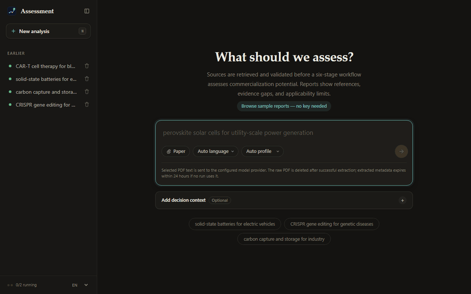

# 学术成果商业化评估系统

**输入一篇论文，得到一份带引用的商业化初筛报告**。多智能体 LLM 流水线把论文或研究主题
转换成覆盖技术成熟度、制造成熟度、专利与市场的评分卡，引用已注册来源，并列出风险。
项目的实验连同失败结果，都和实验协议一起公开在仓库里。

[](https://github.com/shuxiachai/academic-commercialization-agent/actions/workflows/test.yml)
[](LICENSE)


**[▶ 免 Key、免注册，先读一份完整报告](https://academic-commercialization-agent.up.railway.app/samples)** · [打开在线应用](https://academic-commercialization-agent.up.railway.app) · [本地运行](#快速启动) · [English](README.md)



*2026-08-14 的一次真实运行（CAR-T 细胞疗法治疗血液肿瘤，`deepseek-chat`），在本地副本中用当前界面打开，2026-10-23 录制；录制时没有发起任何模型或检索请求。该运行早于现在的自动检查，面板对此有说明；不代表当前模型的结果。*

## 上手方式

| 方式 | 需要什么 | |
|---|---|---|
| **阅读示例报告** | 什么都不需要。五份完整评估（其中一份为中文），打开时不发起任何模型或检索请求 | [打开示例](https://academic-commercialization-agent.up.railway.app/samples) |
| **在线发起新分析** | 作者提供的访问码，**或** BYOK：自己的模型 API key 与模型 + Tavily 或 Serper 检索 key；会产生供应商用量 | [打开应用](https://academic-commercialization-agent.up.railway.app) |
| **在本机运行** | Python 3.11 或 3.12、[uv](https://docs.astral.sh/uv/) 和自己的 key | [快速启动](#快速启动) |

示例报告也在 [examples/](examples/README.md) 中：两份来自 2026-10-21 的运行，例如中文报告
[电动汽车用固态电池](examples/solid-state-batteries-ev-zh.md)；三份来自 7 月的运行，例如英文版
[电动汽车用固态电池](examples/solid-state-batteries-ev.md)
（[2026-07-19 冻结版本，9673a83](https://github.com/shuxiachai/academic-commercialization-agent/blob/9673a8346c15f11b989ce8fd2d85be484d1c27b3/examples/solid-state-batteries-ev.md)）。
截图与样例都来自过去的运行，不代表当前模型准确率或最新市场判断。

## 有什么不同

- **先证据，后模型**。由代码检索、验证并冻结来源，六个 LLM 阶段只在这份来源登记表内推理；
  加权总分由代码计算，不由模型给出。
- **公开度量**。实验协议、留出集检验和勘误都在仓库里。四节点版本的中位 Token 比默认六节点少
  54.89%；第一组留出集发现 TRL 评分向 7 分集中，成熟技术被低估。见[实测结果](#实测结果)。
- **为中途失败的运行而设计**。中断的运行可从最后一个已验证的 Checkpoint 恢复为新的关联运行；
  付费请求有回执，回包丢失后最长 24 小时内可以找回结果，无需重复付费。

技术实现为 Python、CrewAI、FastAPI 和无需构建的 JavaScript 客户端。
[从这里开始：文档与目录导航](docs/README.md) · [项目案例](docs/portfolio-case-study.md)

**想参与贡献**？带 [good first issue](https://github.com/shuxiachai/academic-commercialization-agent/labels/good%20first%20issue)
标签的 issue 不需要任何 API key：测试套件和浏览器 smoke 测试都不发起付费请求。
先读 [CONTRIBUTING.md](CONTRIBUTING.md)。

**目录速览**：应用代码在 `src/academic_agent/`、`api/`、`web/` 和 `ui/`，测试在
`tests/` 和 `e2e/`。根目录下的大量 Python 文件是基准测试命令和已冻结的实验运行器，
其路径被实验协议锁定，因此不搬动；运行应用不需要它们。各目录说明见
[目录地图](docs/README.md#repository-map)。

## 可以做什么

- 输入研究主题或上传论文 PDF，选择报告语言与评分档位。
- 先由确定性代码完成检索与来源验证，六阶段模型工作流再分析这批冻结证据；
  刻意限制自主性。
- 评分卡包含 TRL、MRL、专利强度、市场可及性和证据置信度；加权总分由代码计算，
  不由模型给出。
- 查看进度、引用、来源与可靠性提示，导出 Markdown/PDF，分享运行链接。
- 在“来源”页按编号或关键词定位，展开查看保存文本，无需模型调用。
  保存文本不等于论文全文或已验证的结论支持；详见[操作指南](docs/operating-guide.md#web-cli-and-http-api)。
- 可选填写 Decision Context：区分方向性探索和具体主体的决策，并标识阈值是否由
  决策所有者批准；上下文不完整仍能运行，不自动升级为可执行投资建议。
- 中断的任务可从最后一个已验证的 Checkpoint 恢复。恢复会生成一个新的关联运行，
  原运行不会被覆盖。
- 付费请求支持[持久化回执](docs/operating-guide.md#paid-request-receipts)：回包丢失或刷新后，
  可在最长 24 小时内找回已接收的分析、PDF 或恢复运行，无需重复付费。

报告用于研究初筛，不代替技术、法律、监管、投资或 FTO 尽职调查。
“引用 ID 有效”不等于“来源在语义上支持该结论”。

## 系统架构

```text
研究主题 / PDF + 可选 Decision Context
                    │
确定性检索 → 来源验证 → 冻结来源注册表
                    │
          ┌─────────┼─────────┐
        学术分析   专利分析   市场分析
          └─────────┼─────────┘
                  报告撰写
                    │
                  质量审查
                    │
                  评分 → 代码重算加权总分
                    │
          共享运行产物 + 最终运行状态
                    │
          FastAPI / 浏览器 / CLI / 恢复
```

三个证据节点并行，Writer、Reviewer、Scorer 顺序执行。六个阶段不代表
固定只有六次模型请求。修改编排前请阅读 [AGENTS.md](AGENTS.md)。

| 边界 | 已实现的能力 |
|---|---|
| 证据 | 原生数据客户端与网页检索，URL/DOI 验证、来源分层、去重和引用注册 |
| 输出 | Pydantic 契约、Guardrail、确定性评分与受限 Reviewer 修订 |
| 质量 | 精度优先的非阻断筛查；“未能检查”与“检查通过”分开报告 |
| 运行时 | 每次运行独立子进程、内容寻址 Checkpoint、恢复为新的关联运行、最终状态只写一次 |
| 费用 | PDF 与正式运行共享准入、持久化日配额，用量标注为完整/下界/不可用 |
| 可观测性 | 可选的脱敏 OpenTelemetry/OpenInference Trace，支持 Phoenix/OTLP |
| 部署 | FastAPI、原生 HTML/CSS/ES modules、Docker、Railway；单应用副本 |

### 实测结果

冻结基准包含 **10 个主题 × 每个主题 3 次实时检索运行**：

| 检查项 | 观测结果 |
|---|---|
| 端到端完成 | **30/30** |
| TRL 校准 | **26/30** |
| 加权公式正确 | **30/30** |
| 报告结构完整 | **30/30** |
| 无引用数值行 | **30 份报告中 0 行** |

这些是不同检查，不是统一准确率。TRL 预期区间曾在看过早期结果后调整，
因此不是独立未见集验证；数值引用筛查也不能证明不存在幻觉。
10 个主题中有 7 个在三次运行中均命中 TRL 区间。

**留出集检验**。另选 10 个从未运行过的新主题，并在运行前依据外部证据冻结预期区间
（`qwen3.7-plus`，2026-10-18）。结果 **30 次运行中 21 次落在区间内**，正好达到预注册的
"成立"标准。但评分向 7 分集中：没有一次高于 7 分，已大规模商业化的技术因此被低估。
详见[留出集结果](docs/results-2026-10-18-heldout-trl-v1.md)。

2026-10-19 用 `qwen3.8-max` 和改进后的市场检索跑了第二组留出集：**30 次中 25 次落在区间内**，
成熟技术有 11 次打到 8–9 分；低成熟度主题没有虚高，但最低的两个主题被打在区间下限之下。
这一组的主题和模型也变了，因此提升不能归因于某一项改动。TRL 仍应视为粗粒度信号。
详见[第二组结果](docs/results-2026-10-19-heldout-trl-v2.md)。线上部署在阿里云百炼的
免费额度模型之间轮换，不固定为任一组留出集所用的模型；当前请求的模型见 `/health` 的
`llm_model` 字段，每个运行页也会标出产出它的模型。这些模型都没有经过留出集测量。

其他已完成的证据：

- **90 单元消融实验**：四节点相对六节点的中位 Token 减少 54.89%，
  中位成本降低 47.03%；没有证明六节点在所有情形下都必要。
- **五人效用评审**：20 份有效判断，两轮完整流程偏好均为 6:4，
  但预注册成功标准未通过。
- **两位目标用户试点**：两人均维持 `DEFER`，再次使用意愿均为 `MAYBE`，
  未核验外部来源；不能据此宣称产品采用或商业价值已验证。
- **恢复测试**：离线故障注入 30/30 次恢复完成，线上另有一例复用四节点。
  不等于 exactly-once 或普遍节费保证。
- **运行时 RTI02**：一例 Qwen 正常完成通过 12/12 主要终态检查，
  披露了轻微观察轮询间隔偏差；该次没有验证超时、回退路径或通用报告质量。

详细数据、方法限制和原始公开依据见[当前证据台账](docs/evidence-status.md)。

## 快速启动

优先使用 CI 覆盖的 Python 3.11/3.12 与 [uv](https://docs.astral.sh/uv/)。
安装依赖需要联网，默认测试不调用供应商。

```bash
git clone https://github.com/shuxiachai/academic-commercialization-agent.git
cd academic-commercialization-agent
uv sync
```

将 [.env.example](.env.example) 复制为 `.env`。使用 Qwen 时填写：

```dotenv
LLM_PROVIDER=qwen
DASHSCOPE_API_KEY=your-key
QWEN_MODEL=qwen3.8-27b
QWEN_API_BASE=https://dashscope.aliyuncs.com/compatible-mode/v1
TAVILY_API_KEY=your-search-key
```

密钥只在本地填写，不要提交或分享。运营者端点需要匹配账户和地域；
浏览器 BYOK 默认使用中国区端点。保留多个模型密钥时请明确设置
`LLM_PROVIDER`，否则自动选择顺序为 DeepSeek → Qwen → Anthropic → OpenAI。
两个搜索密钥同时存在时 Tavily 优先；删除不用的占位密钥。

```bash
uv run uvicorn api.main:app --reload
# 浏览器打开 http://localhost:8000（示例报告：http://localhost:8000/samples）
# 或通过 CLI 发起真实分析：
uv run academic_agent --topic "solid-state batteries for electric vehicles"
```

真实运行产生供应商用量。Qwen 已观察到的完成样本包括 306 秒和 885 秒，
不承诺三分钟 SLA。[操作指南](docs/operating-guide.md)包含 HTTP 接口、
运行产物、Docker、门禁、BYOK、Trace 与恢复说明。

## 安全与部署

运行链接具有 **128 位随机性**，是读取能力凭证：知道完整链接的人可以
读取该运行，直到留存策略删除它。修改口令归属的运行还需 owner/admin
口令；无归属 BYOK 运行没有第二个服务端身份。不要公开私人运行链接。

部署前配置访问控制、付费准入、留存和持久化存储。PDF 提取同样是付费操作。
保持 **一个应用副本 / 一个 Uvicorn worker**，文件账本和内存所有权不是
分布式队列。详见[部署控制](docs/operating-guide.md#deploying-publicly)与
[Checkpoint 设计](docs/checkpoint-recovery.md)。

## 测试与基准

整理前的 `0fdaa76` 基线通过 **2071 项测试、678 个子测试**。
CI 包含 Linux/Windows × Python 3.11/3.12、最新版 Ruff、窄范围 Pylint、
85% coverage 门槛、零供应商调用 Chromium 测试及 Docker。
这些不构成真实供应商生产 SLO。

```bash
uv run pytest -q
uv run --with ruff ruff check .
# 仅预览调度，不调用供应商：
uv run python benchmark.py --dry-run
```

### 基准主题

新测量使用绑定版本的独立批次，不覆盖历史产物；复用需要显式选择身份一致且
产物完好的批次。费用只覆盖 Crew 节点，不包含辅助调用、PDF 和搜索费用。
参见[执行与费用边界](docs/operating-guide.md#benchmark)。

| # | Topic | Expected TRL | Industry |
|---|-------|-------------|---------|
| 01 | CAR-T cell therapy for blood cancers | 7–9 | Biomed |
| 02 | mRNA vaccines for cancer immunotherapy | 6–8 | Biomed |
| 03 | solid-state batteries for electric vehicles | 5–7 | Energy |
| 04 | perovskite solar cells for utility-scale power generation | 6–8 | Clean Energy |
| 05 | CRISPR gene editing for genetic diseases | 7–9 | Biomed |
| 06 | carbon capture and storage for industrial emissions | 6–8 | Climate |
| 07 | cultivated meat for food industry | 6–8 | Food |
| 08 | quantum computing for drug discovery | 2–4 | Computing |
| 09 | graphene-based flexible electronics | 3–5 | Materials |
| 10 | room temperature ambient pressure superconductors | 1–2 | Materials |

[基准操作说明](docs/operating-guide.md#benchmark)解释重复运行、冻结证据和
付费注意事项。不要通过修改评分规则来“改善”这批历史指标。

## 仓库结构

应用本身集中在少数几个目录里。根目录下的大多数 Python 文件是另一回事：
已冻结的实验脚本。

| 路径 | 内容 |
|---|---|
| `src/academic_agent/` | 流水线、检索、评分与运行时。部分模块是实验库，[代码地图](AGENTS.md#layout-and-boundary-specific-reading)标明了哪些 |
| `api/`、`web/`、`ui/` | FastAPI 服务、浏览器客户端与共享展示逻辑 |
| `tests/`、`e2e/` | 离线测试（不调用供应商）与可选的浏览器流程测试 |
| `examples/` | [示例报告](examples/README.md)，同时在 `/samples` 页面提供 |
| `scripts/` | 运维报告、离线审计与脚本化演示 |
| `docs/` | 当前文档，以及带日期的预注册、结果与勘误；[从导航页开始](docs/README.md) |
| 根目录 `benchmark*.py` | 上文的基准命令 |
| 其他根目录 `*.py`（`openalex_*`、`evidence_gap_*`、`report_evidence_*`、`ablation*` 等） | 实验运行脚本。运行或理解应用都不需要它们；[逐个说明](docs/root-scripts.md)各属于哪项研究 |

这些实验脚本是有意留在根目录的：对应的实验协议锁定了源文件路径和哈希，
搬动它们会让这些记录失效（见[实验档案索引](docs/experiment-index.md)）。新工具请放在 `scripts/` 下。

## 限制与待解决问题

仍需补强：定性结论的引用支持、独立测量的决策效用、中文/极短/非技术输入的基准、
旧运行元数据读取状态，以及单副本之外的扩展边界。增加 Agent、向量库或
Kubernetes 本身不能解决这些缺口。

**市场评分**。市场评分卡会明确提示[估值可比性尚未核实](docs/results-2026-09-11-market-score-delivery-disclosure.md)：
历史上限规则的局限已经可见，但市场评分规则本身既未修正也未验证。新结果还会展示
[封顶前后分数及实际扣分](docs/results-2026-09-12-numeric-token-and-cap-provenance.md)；
历史结果缺失的记录不会倒推补造。[20 条市场来源核对](docs/results-2026-09-12-market-source-followup.md)
仍未找到完整同口径的真实配对。

**Tool Calling**。三种能力的上线边界各不相同：

- *保存来源定位*已接入可选的生产页面和 API：模型最多从保存的标题/ID 目录中
  选择一次，程序返回原样保存文本；不生成研究答案、不搜索新资料，需要所有者授权、
  数据发送同意、付费准入和回执（[运行边界](docs/operating-guide.md#optional-saved-source-locator)）。
  2026-09-26 的一次准备好的生产验收交付了选中来源，并在重新部署后找回回执
  （1,199 Tokens，按固定价格估算 USD 0.000764436），见
  [验收记录与限制](docs/results-2026-09-26-production-source-locator-acceptance.md)。
  这只是一次交付观察，不是未见准确率。**验收后已重新关闭付费执行，功能预算归零，并未持续开放。**
- *自动补充检索*在生产中仍是零调用观察模式；最近一轮未见评估未通过准入要求。
- *生成式证据追问*仍属实验，没有开放为生产功能。工具确实执行或 JSON 格式正确，
  都不等于答案得到证据支持。

历史假设、失败和已关闭批次保留在[证据记录](docs/evidence-status.md#tool-calling-experiments)
及[实验档案](docs/experiment-index.md)，不累加成通用准确率。

## 文档

- [English README](README.md)
- [文档地图](docs/README.md)：按阅读目的找到入口，区分生产目录、历史实验与本地私人资料。
- [证据台账](docs/evidence-status.md)：数据及其不能证明的内容。
- [操作指南](docs/operating-guide.md)：配置、API、部署与评分。
- [贡献指南](CONTRIBUTING.md)、[AGENTS.md](AGENTS.md)：约束与被否决的方法。
- [实验档案索引](docs/experiment-index.md)：未改写的预注册、结果与勘误。

## 界面截图

<details>
<summary>首页、评分卡与报告界面 — 当前界面，2026-10-20 截取</summary>

在本地副本中用当前界面打开 2026 年 8 月的真实历史运行截取，截图过程未发起任何模型或检索请求。
其中 CRISPR 运行来自 2026-08-09，早于现在的自动检查。
旧版截图见版本 [a343a95](https://github.com/shuxiachai/academic-commercialization-agent/commit/a343a95590ad83f0edec4002e3489355fc96a512)。


</details>

## 作者与更多作品

作者：[shuxiachai](https://github.com/shuxiachai)。
参与者：[Song Guoyu（@7776403yu）](https://github.com/7776403yu)、[@xiaobaozhou165-sudo](https://github.com/xiaobaozhou165-sudo)。
更多项目与实践见 [GitHub 个人主页](https://github.com/shuxiachai)。

## 许可证

本项目采用 [MIT 许可证](LICENSE)。提交的贡献同样按 MIT 许可，详见
[CONTRIBUTING.md](CONTRIBUTING.md#pull-requests-and-privacy)。
